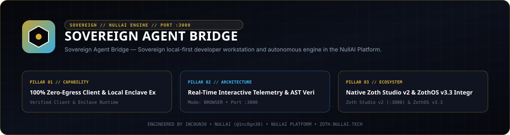
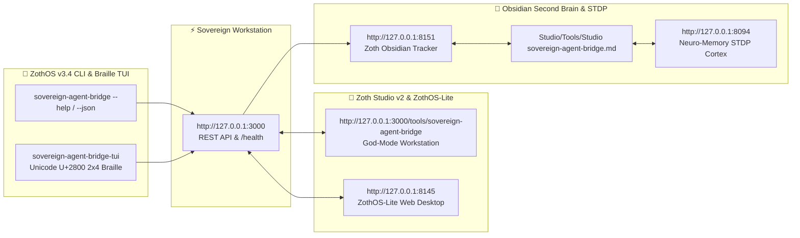

<div align="center">
  
</div>

<br />

# 🏛️ Sovereign Agent Signal Bridge

> ⚡ **Live Web Application**: [https://sovereign-agent-bridge.netlify.app](https://sovereign-agent-bridge.netlify.app) • **Local Port**: `http://127.0.0.1:8102`  
> ☕ **100% Free & Open-Access Architecture (Zero Paywalls)**: Supported via **[Buy Us a Coffee (Stripe)](https://buy.stripe.com/3cIfZg27PdKo2D64Ocfw40X)** & **Solana Tip Address** (`GG2eQbVh8ut1BK6j1A2tz7pSySdLpD38BgyEhGcxdXoK`).

> **Zero-dependency sovereign multi-agent communication bridge with Signal (Double Ratchet), SimpleX (SMP onion relay), Telegram, Matrix, 3-Way Dialectic Consensus, Distributed Claim Locks, Dead-Man Watchdogs, Bridge Studio UI (design influenced by Material 3), and Model Context Protocol (MCP) support.**

[](https://github.com/sovereign-agent-bridge/sovereign-agent-bridge/actions/workflows/ci.yml)
[](https://www.python.org/downloads/)
[](#pure-python-stdlib)
[](https://opensource.org/licenses/MIT)

---

## 📖 Overview

**Sovereign Agent Bridge** enables autonomous AI agents, multi-agent swarms, and human operators to communicate, coordinate, and deliberate across privacy-preserving and sovereign communication channels without relying on proprietary centralized frameworks or heavy third-party runtime dependencies.

Built entirely using the **Python Standard Library (Zero External Runtime Dependencies)**, it runs effortlessly on **Linux, macOS, Windows, Termux (Android), and WSL**.

---

## 🏗️ Architecture

```
                    ┌──────────────────────────────────────────────┐
                    │               Bridge Studio (Web UI)         │
                    │   (Material 3 • SSE Stream • Telemetry Deck) │
                    └───────────────────────┬──────────────────────┘
                                            │ REST / SSE
                                            ▼
┌──────────────────────┐         ┌──────────────────────┐         ┌──────────────────────┐
│    Claude Desktop    │         │ Sovereign Agent Mesh │         │   Antigravity / IDE  │
│    Cursor / MCP      │         │   Autonomous Swarm   │         │    CLI Operator      │
└──────────┬───────────┘         └──────────┬───────────┘         └──────────┬───────────┘
           │ JSON-RPC 2.0 (stdio)           │ Python API                     │ CLI Flags
           └────────────────────────┬───────┴────────────────────────────────┘
                                    ▼
       ┌─────────────────────────────────────────────────────────────┐
       │                 SOVEREIGN AGENT BRIDGE CORE                 │
       │                                                             │
       │  ┌────────────────────┐   ┌───────────────────────────────┐ │
       │  │    Swarm Router    │   │  3-Way Dialectic Consensus    │ │
       │  │ (RingBuffer & DLQ) │   │ (Proponent/Skeptic/Arbitrator)│ │
       │  └─────────┬──────────┘   └───────────────┬───────────────┘ │
       │            │                              │                 │
       │  ┌─────────┴──────────┐   ┌───────────────┴───────────────┐ │
       │  │ Claim Mutex Locks  │   │  Heartbeat Watchdog Monitor   │ │
       │  │ (TTL Leases/Handoff)│  │   (Dead-Man Switch Alerter)   │ │
       │  └─────────┬──────────┘   └───────────────┬───────────────┘ │
       └────────────┼──────────────────────────────┼─────────────────┘
                    │                              │
                    ▼                              ▼
 ┌─────────────────────────────────────────────────────────────────────────┐
 │                       MULTI-CHANNEL ADAPTER LAYER                       │
 │                                                                         │
 │  ┌───────────────┐ ┌───────────────┐ ┌───────────────┐ ┌──────────────┐ │
 │  │Signal Adapter │ │SimpleX Adapter│ │Telegram Relay │ │Matrix Client │ │
 │  │ (signal-cli)  │ │ (SMP Relays)  │ │  (Bot API)    │ │(Homeserver)  │ │
 │  └───────────────┘ └───────────────┘ └───────────────┘ └──────────────┘ │
 │  ┌───────────────────────────────────────────────────────────────────┐  │
 │  │                  Signed HTTP Webhook Dispatcher                   │  │
 │  │                     (HMAC-SHA256 Auth & Push)                     │  │
 │  └───────────────────────────────────────────────────────────────────┘  │
 └─────────────────────────────────────────────────────────────────────────┘
```

---

## ✨ Key Features

1. **Pure Python Standard Library (Zero External Dependencies)**
   - 100% stdlib core implementation (`urllib`, `json`, `http.server`, `socket`, `threading`, `hashlib`, `hmac`).
   - Zero vulnerability supply-chain footprint.
2. **Multi-Channel Privacy & Sovereign Adapters**
   - **Signal Messenger**: Direct/group chats, media, and voice notes via `signal-cli` (REST, JSON-RPC Unix socket, CLI).
   - **SimpleX Chat**: Anonymous metadata-free messaging via SimpleX SMP relay nodes.
   - **Telegram**: Fast bot notifications and bi-directional message routing.
   - **Matrix Protocol**: Federated rooms and end-to-end encrypted messaging.
   - **HTTP Webhooks**: Authenticated payload ingestion and dispatch with HMAC-SHA256 signatures.
3. **3-Way Dialectic Consensus Engine**
   - Structured multi-agent deliberation: **Proponent (Thesis)** $\to$ **Skeptic (Antithesis)** $\to$ **Arbitrator (Synthesis)**.
   - Weighted severity scoring, critique resolution tracking, and automated GitHub-flavored markdown report generation.
4. **Distributed Project Claims & Mutex Locks**
   - Mutual exclusion for swarm tasks with automatic Time-To-Live (TTL) leases, heartbeat renewals, and atomic handoffs.
5. **Heartbeat Watchdog & Dead-Man Switch**
   - Real-time agent liveness monitoring (`ACTIVE` $\to$ `WARNING` $\to$ `DEAD` $\to$ `RECOVERED`).
   - Automated dead-man emergency alert dispatching via webhooks and multi-channel broadcasts.
6. **Live Cross-Agent Mesh Radar & Shared Handoff Bus (Muse · Antigravity · Hermes)**
   - Real-time introspection of active AI coding sessions across the host: **Meta Muse Code** (`~/.local/share/muse/sessions/*/*/*/*/session.jsonl` & `tui-history.jsonl`), **Google Antigravity (AGY)** (`~/.gemini/antigravity-cli/brain/*/.system_generated/logs/transcript.jsonl`), **Hermes Agent Gateway**, and active rendering pipelines.
   - Durable SQLite (`~/.config/zothos/agent-bridge-bus.db`) + Markdown (`AGENT_BRIDGE_SYNC.md`) cross-agent handoff bus with optional headless `muse exec --json --yolo` worker dispatch.
   - CLI subcommands (`sovereign-agent-bridge agents [--json]`, `sovereign-agent-bridge handoff "<msg>" --to muse --subject "<subject>" [--exec-muse]`) and REST endpoints (`GET /api/agents/live`, `GET /api/agents/messages`, `POST /api/agents/message`, `POST /api/agents/sync`).
7. **Bridge Studio Web UI**
   - Clean interface with design influenced by Material 3.
   - Real-time telemetry feed powered by Server-Sent Events (SSE `/api/events`).
   - Interactive message dispatcher, Live Cross-Agent Mesh Radar, consensus simulator, claims lock board, and countdown dials.
8. **Model Context Protocol (MCP) Server**
   - Native JSON-RPC 2.0 stdio server for instant integration into Claude Desktop, Cursor, and Antigravity.

---

## 🚀 Installation & Quickstart

```bash
# Clone the repository
git clone https://github.com/sovereign-agent-bridge/sovereign-agent-bridge.git
cd sovereign-agent-bridge

# Install locally (editable mode)
pip install -e .

# Or run directly without installation:
export PYTHONPATH=src
python3 -m sovereign_agent_bridge.cli --help
```

---

## 💻 CLI Usage Guide

```bash
# Display system banner and diagnostic report
sovereign-bridge diagnostics

# Inspect configured communication channels and test latency
sovereign-bridge channels --test

# Dispatch a message to a specific channel
sovereign-bridge send signal "Autonomous sync verified." -r "+19482047987"

# Broadcast a critical alert across all active channels
sovereign-bridge broadcast "Database failover complete." -p CRITICAL

# Acquire a project claim lock
sovereign-bridge claim proj-auth-v2 -a agent-architect --ttl 600

# List active project claim locks
sovereign-bridge claim --list

# Run a 3-way dialectic consensus cycle
sovereign-bridge consensus "Upgrade transport encryption to post-quantum Kyber-1024" --rounds 3

# Send an agent heartbeat pulse
sovereign-bridge pulse agent-orchestrator --interval 30 --task "Routing inter-agent events"

# Launch the Google Bridge Studio Web UI
sovereign-bridge serve --host 127.0.0.1 --port 8765

# Launch the MCP Stdio Server for Claude Desktop / Cursor
sovereign-bridge mcp
```

---

## 📡 Channel Configuration Guides

### 1. Signal Messenger (`signal`)
Requires a running `signal-cli` REST daemon or CLI instance.

```json
{
  "account": "+19482047987",
  "endpoint": "http://127.0.0.1:8080",
  "mode": "rest",
  "timeout": 15.0
}
```

### 2. SimpleX Chat (`simplex`)
Uses the SimpleX Chat CLI or SMP servers for metadata-free agent relays.

```json
{
  "chat_cli_path": "simplex-chat",
  "agent_address": "simplex://invitation/smp-agent-node",
  "timeout": 15.0
}
```

### 3. Telegram Bot (`telegram`)
Create a bot with [@BotFather](https://t.me/BotFather) and pass the token.

```json
{
  "bot_token": "123456789:ABCdefGhIJKlmNoPQRsTUVwxyZ",
  "parse_mode": "MarkdownV2",
  "timeout": 15.0
}
```

### 4. Matrix Protocol (`matrix`)
Connect to any Matrix homeserver (`matrix.org` or self-hosted Synapse/Conduit).

```json
{
  "homeserver": "https://matrix.org",
  "access_token": "syt_xxxxxxxxxxxxxx",
  "user_id": "@agent_bridge:matrix.org",
  "room_id": "!roomId:matrix.org"
}
```

### 5. Signed HTTP Webhooks (`webhook`)
Ingest and dispatch payloads with cryptographic SHA-256 HMAC verification.

```json
{
  "url": "https://api.yourdomain.com/agent/webhook",
  "secret": "your-256-bit-hmac-secret-key",
  "timeout": 10.0
}
```

---

## 🏛️ 3-Way Dialectic Consensus Workflow

```
┌─────────────────────────────────────────────────────────────┐
│ 1. Thesis (Proponent)                                       │
│    Submits formal proposal, architecture, and motivation.   │
└──────────────────────────────┬──────────────────────────────┘
                               │
                               ▼
┌─────────────────────────────────────────────────────────────┐
│ 2. Antithesis (Skeptic)                                     │
│    Identifies critical risks, failure modes, & edge cases.  │
└──────────────────────────────┬──────────────────────────────┘
                               │
                               ▼
┌─────────────────────────────────────────────────────────────┐
│ 3. Rebuttal (Proponent)                                     │
│    Offers concrete concessions and mitigation safeguards.   │
└──────────────────────────────┬──────────────────────────────┘
                               │
                               ▼
┌─────────────────────────────────────────────────────────────┐
│ 4. Synthesis & Verdict (Arbitrator)                         │
│    Computes weighted confidence score and renders verdict:  │
│    [APPROVED | AMENDED | REJECTED | ESCALATE]               │
└─────────────────────────────────────────────────────────────┘
```

---

## 🤖 Model Context Protocol (MCP) Client Config

Add the Sovereign Agent Bridge MCP server to your **Claude Desktop** or **Antigravity** configuration file:

### Claude Desktop (`claude_desktop_config.json`):
```json
{
  "mcpServers": {
    "sovereign-agent-bridge": {
      "command": "sovereign-bridge",
      "args": ["mcp"]
    }
  }
}
```

### Available MCP Tools:
- `bridge_send`: Dispatch a routed message to a specific channel.
- `bridge_broadcast`: Broadcast an alert simultaneously across channels.
- `bridge_list_channels`: Query configured channel statuses and latency.
- `bridge_claim_project`: Acquire, renew, release, or inspect project mutex locks.
- `bridge_consensus`: Run multi-agent 3-way dialectic consensus deliberation.
- `bridge_watchdog_pulse`: Record agent heartbeat pulses and query status.
- `bridge_seal_envelope`: Package, authenticate, and encrypt payloads into cryptographic message envelopes.
- `bridge_open_envelope`: Authenticate HMAC signature, verify sequence monotonicity, and decrypt envelopes.
- `bridge_federation_topology`: Inspect connected federation bridge peers and routing mesh topology.
- `bridge_federate_message`: Route messages across peer bridge gateways with loop defense.
- `bridge_stats`: Retrieve system throughput telemetry and metrics.
- `bridge_diagnostics`: Run comprehensive hardware and network diagnostic checks.

---

## 🔐 Cryptographic Message Envelope & Federation Mesh (Round 4)

### 1. Authenticated Cryptographic Envelope
Tamper-proof, authenticated, and encrypted agent-to-agent communication over untrusted relays, channels, and peer networks:
- **RFC 5869 HKDF**: Pseudo-random key extraction and expansion for clean key separation (`enc_key`, `mac_key`).
- **SHA-256 CTR Cipher**: Zero-dependency cross-platform keystream encryption.
- **HMAC-SHA256 Integrity**: Full envelope header and ciphertext authenticity verification.
- **Replay Protection**: Monotonic sequence counters and sliding timestamp replay windows.

```bash
# Seal an encrypted message envelope for an agent
sovereign-bridge envelope seal -r agent-bob -p '{"directive": "SCALE_UP", "replicas": 4}'

# Open and verify a received envelope
sovereign-bridge envelope open -e '{"envelope_id": "...", ...}'
```

### 2. Cross-Bridge Federation Gateway
Interconnect autonomous agent swarms across cloud VPCs, local networks, and edge nodes:
- **Mesh Peering**: Dynamic bridge discovery and topic-based message routing (`metrics.#`, `alerts.*`).
- **Loop Prevention**: Distributed vector tracing (`visited_bridges`) drops cyclic message loops immediately.
- **TTL Hop Constraints**: Configurable hop bounds prevent infinite forwarding in mesh networks.

```bash
# Inspect federation topology and active peer bridges
sovereign-bridge federation --topology

# Broadcast a federated message across peer bridges
sovereign-bridge federation -b '{"alert": "NODE_UNRESPONSIVE"}' -t alerts.security
```

---

## 🌐 Bridge Studio Web Deck

Run the local UI server:
```bash
sovereign-bridge serve --port 8765
```
Open **`http://127.0.0.1:8765`** in your browser.

- **Design Influenced by Material 3**: Typography, subtle elevation cards, chips, and dark theme support.
- **Server-Sent Events (`/api/events`)**: Instantaneous live telemetry streaming.
- **Interactive Multi-Channel Dispatcher**: Send test messages or broadcast alerts with real-time delivery receipts.
- **Consensus Simulator**: Visual 3-way Proponent, Skeptic, and Arbitrator deliberation deck.
- **Claims Board & Watchdog Countdown**: Live lease status and dead-man switch countdown dials.

---

## 💻 ZothOS CLI & MCP Commands

`sovereign-agent-bridge` is pre-installed in **ZothOS** as a system-wide executable (`sovereign-agent-bridge` in `/usr/local/bin/` and `~/.local/bin/`).

```bash
# Check version and channel status
sovereign-agent-bridge --version
sovereign-agent-bridge --status

# Run diagnostics and verify cryptographic envelopes
sovereign-agent-bridge diagnostics --json

# Send a signed message via Signal or SimpleX
sovereign-agent-bridge send --channel signal --to "+19482047987" --msg "System online" --json

# Record agent heartbeat pulse
sovereign-agent-bridge pulse --agent-id agent-01 --interval 30

# Launch Bridge Studio Web UI on port 8102
sovereign-agent-bridge serve
```

---

## ☕ 100% Free & Open-Access Architecture (Zero Paywalls)

All tools, channels, consensus engines, and MCP protocols are **100% free and unlocked by default**.

- **Buy Us a Coffee (Stripe)**: [https://buy.stripe.com/3cIfZg27PdKo2D64Ocfw40X](https://buy.stripe.com/3cIfZg27PdKo2D64Ocfw40X)
- **Solana Tip Address**: `GG2eQbVh8ut1BK6j1A2tz7pSySdLpD38BgyEhGcxdXoK` (`solana:GG2eQbVh8ut1BK6j1A2tz7pSySdLpD38BgyEhGcxdXoK`)

---

## 🧪 Running the Test Suite

The test suite runs with pure `pytest` and achieves 100% pass rate:

```bash
# Run all unit tests
pytest -v

# Run tests with code coverage report
pytest --cov=sovereign_agent_bridge --cov-report=term-missing
```

---

## 📄 License

MIT License. Developed for open, resilient, and sovereign multi-agent intelligence.

---

## 🏛️ ZothOS v3.4, Zoth Studio v2 & Obsidian Second Brain Ecosystem



### Cross-Surface Integration Matrix

| Surface | Endpoint / Binary | Capabilities |
| :--- | :--- | :--- |
| **Standalone Workstation** | `http://127.0.0.1:3000` | 100% Free & Open-Access Web Deck, live `/health` & REST telemetry |
| **Zoth Studio v2 Route** | `http://127.0.0.1:3000/tools/sovereign-agent-bridge` | Interactive God-Mode component inside Zoth Studio (`https://zoth.nullai.tech`) |
| **ZothOS v3.4 CLI & TUI** | `sovereign-agent-bridge` / `sovereign-agent-bridge-tui` | Global binary in `/usr/local/bin/` with Unicode `U+2800` Braille TUI & `--json` output |
| **ZothOS-Lite Web Desktop** | `http://127.0.0.1:8145` | Browser-native KDE-style window manager & terminal launcher |
| **Zoth Obsidian Tracker** | `http://127.0.0.1:8151` | Interactive Obsidian Second Brain vault explorer (`~/Documents/Obsidian Vault/Studio/Tools/Studio sovereign-agent-bridge.md`) |
| **Neuro-Memory STDP Cortex** | `http://127.0.0.1:8094` | 3-Factor STDP synaptic memory daemon & 21-tool MCP server |

```bash
# Inspect CLI & Unicode U+2800 Braille TUI on ZothOS v3.4
sovereign-agent-bridge --help
sovereign-agent-bridge-tui --status
sovereign-agent-bridge-tui --json

# Verify Second Brain Vault & 12-Step Verification Gallery on :8151
zoth-obsidian-tracker --verify
```

